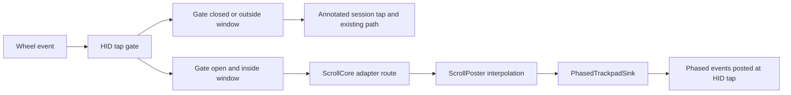

# iPhone 镜像滚动适配 (项目 A)

面向开发者与后续维护的 agent。本文描述 Mos 在 iPhone 镜像 (iPhone Mirroring, bundle id com.apple.ScreenContinuity) 窗口内的滚动输出路径。实验依据见研究分支 research/iphone-mirroring-scroll 的 docs/research/iphone-mirroring-scroll/03-experiment-log.md。

## 范围

- 包含: 光标位于镜像窗口内时, 鼠标滚轮经 Mos 平滑后以触控板式 phased 事件送达镜像
- 不包含: 虚拟妙控板的触摸输出 (项目 B), 帧时钟与 60 Hz 时间归一化, Monitor 重做为 Lab

## 方案

### 组成

iPhone 镜像以应用滚动适配器的形式接入, 框架与接入规范见 .agents/docs/scroll-adapters.md。

| 组件 | 位置 | 职责 |
|---|---|---|
| ScrollAdapterCenter | Mos/ScrollCore/Adapters/ScrollAdapterCenter.swift | 按系统版本注册适配器, 监听目标应用启动与退出, 持有共享 HID tap 与捕获闸门 |
| IPhoneMirroringAdapter | Mos/ScrollCore/Adapters/IPhoneMirroring/IPhoneMirroringAdapter.swift | 声明 macOS 15 门槛, 缓存镜像窗口矩形, 给出路由 |
| PhasedTrackpadSink | Mos/ScrollCore/Adapters/Shared/PhasedTrackpadOutput.swift | 手势状态机与 phased 事件构造, 在投递队列上从 HID 层投递 |
| VirtualTrackpadIdentity | Mos/ScrollCore/Adapters/Shared/VirtualTrackpadIdentity.swift | 共享的虚拟 Magic Trackpad 2, 只提供 sender 身份, 按引用计数创建与销毁 |

### 事件流

- 镜像未运行时不创建 HID tap; 镜像运行时 tap 默认禁用
- 光标进入镜像窗口的可见区域 (由刷新或标准路径检测到) 或镜像切到前台时启用 tap; 刷新发现光标离开, 或 HID tap 遇到窗口外的事件时禁用。可见区域为窗口矩形减去上方其他应用的窗口; 镜像在前台时每 0.25 秒刷新, 在后台时每 1 秒刷新
- 窗口内的鼠标滚轮事件由 HID tap 消费, 按镜像应用的例外设置决定平滑与翻转, 然后进入 ScrollPoster 的插值
- ScrollPoster 在适配器路由下把每帧位移交给 PhasedTrackpadSink, 会话结束时请求结束手势; 适配器路由不使用 ScrollPhase 的阶段与惯性
- 触控板事件, 远程桌面平滑事件和 Mos 自身合成的事件在 HID tap 中放行

### 手势状态机

| 输入 | 手势未开始 | 手势进行中 |
|---|---|---|
| 一帧位移, 取整后不为 0 | 发送打断信号 (惯性结束, 预备, 取消), 预备, Began | Changed |
| 一帧位移, 取整后为 0 | 不发送, 余量结转到下一帧 | 不发送, 余量结转到下一帧 |
| 结束请求 (会话结束, 刹停, 复位) | 不发送 | 光标在窗口内时发送 Ended; 不在窗口内时放弃手势 |
| 一帧位移时光标已离开窗口 | 不发送 | 放弃手势, 丢弃本帧 |

镜像路由不发送惯性事件, iOS 按 Ended 时的手势速度自行滑行。

### 事件字段

| 字段 | 取值 |
|---|---|
| 11 / 12 行位移 | 帧位移的符号, 最先写入 |
| 96 / 97 像素位移 | 帧位移取整后的值, 在行位移之后写入 |
| 93 / 94 定点位移 | 帧位移除以 10, 在行位移之后写入 |
| 175 / 176 加速位移, 177 / 178 原始位移 | 帧位移 (倍率 1) |
| 87 sender | 虚拟 Magic Trackpad 2 的 AppleMultitouchDevice 注册表 ID |
| 88 连续滚动 | 1 |
| 99 阶段 / 123 惯性阶段 | 见手势状态机, 惯性阶段固定为 0 (打断信号中的惯性结束除外) |
| 42 eventSourceUserData | Mos 合成平滑事件标记, 供 Mos 的 tap 识别并跳过 (新建事件的该字段为 0, 写入有效) |

每个 phased 事件伴随一个 type 29 手势事件, 与实验基线保持一致。

事件不写入 location, 保留创建时的光标位置: HID 层投递会把光标移到事件的 location, 写入会话开始时的位置会把光标锁在原地 (2026-10-12 实机反馈)。HID 层事件投递给光标下的窗口, 因此每帧检查光标是否仍在镜像窗口的可见区域内; 离开时放弃手势并丢弃剩余插值, 不发送 Ended (它会被送往光标下的其他应用), 镜像侧由下一次手势开头的打断信号复位。

### 虚拟设备

- 首个使用它的适配器激活时创建, 最后一个停用时销毁
- 设备以 VendorID 0x05AC, ProductID 0x0281, I2C 传输发布, 应答 AppleMultitouch 驱动的特性报文握手; 握手完成后出现 AppleMultitouchDevice, 其注册表 ID 作为 sender
- 序列号 Mos Scroll Identity, LocationID 0x4D6F7321 (ASCII Mos!), 用于在 ioreg 与 hidutil 中辨认 Mos 的设备
- 注册表 ID 由内核分配, sender 无法自定义取值

### 降级

以下任一条件不满足时, HID tap 放行全部事件, 行为与改动前一致:

- macOS 15 或更高版本
- 签名包含 com.apple.developer.hid.virtual.device
- 虚拟设备握手完成并取得 sender
- 镜像正在运行, 且光标位于镜像窗口内

### 签名

参照 Karabiner-Elements 的做法: 正式版由维护者签名, 从源码构建的开发者使用自己的签名身份, 受限能力不可用时功能降级。

| 配置 | entitlements | 说明 |
|---|---|---|
| Release | Mos/MosRelease.entitlements, 含 com.apple.developer.hid.virtual.device | 归档与 Developer ID 导出需要 -allowProvisioningUpdates, 由 Xcode 获取包含该能力的描述文件 |
| Debug (默认) | Mos/MosDebug.entitlements, 为空 | 由 Config/MosDebug.xcconfig 指定, 任何开发者账号都能完成签名 |
| Debug (维护者) | Mos/MosDebugVirtualHID.entitlements, bundle id 改为 com.caldis.Mos.dev | 复制 Config/MosDebug.local.xcconfig.example 为 Config/MosDebug.local.xcconfig (已加入 .gitignore)。com.caldis.Mos.debug 无法注册到团队 N7Z52F27XK (2026-10-12 自动签名报 not available), 因此改用独立 bundle id; 该 App ID 需要在开发者后台启用 HID Virtual Device |

## 设计决策

| 决策 | 理由 | 放弃的方案 |
|---|---|---|
| 共用一个按需启用的 HID tap, 保留 Annotated Session tap | 2020 年的提交 29aaf40 把滚动 tap 移到 Annotated Session 层, 目的是读取事件的目标 pid 以支持按应用例外; HID 层事件不带目标 pid。实验中 Annotated Session 层的处理对镜像无效 | 整体迁到 HID 层: 需要另行解决目标应用识别, 影响全部应用 |
| sender 固定使用虚拟 Magic Trackpad 2 | 实验 E2 中 sender 为 0 或物理鼠标均不可用, 只有触控板类设备可用; E3 盲测中虚拟设备与内置触控板没有稳定差异。固定身份省去设备检测, 避免同一会话内切换 sender (E3-Y 首轮在切换后无反应) | 优先借用内置或外接触控板: 需要设备检测与插拔处理, 没有触控板的 Mac 仍需虚拟设备 |
| 镜像路由不发送惯性 | 实验 E1 中镜像的滑行距离与 Mac 侧惯性衰减无关, Mac 侧惯性只带来首帧和交接处的卡顿 | 沿用 Mos 模拟触控板的插值尾段 Momentum 标记 |
| 未平滑的轴原样放行, 翻转时同步取反 175-178 | 用户关闭平滑时保持关闭; 镜像读取 175-178, 只改公开位移时翻转不生效 | 未平滑时也转换为 phased 事件: 需要额外的结束计时 |
| 放行事件在标准路径按位置跳过 | eventSourceUserData 一经写入非零值便无法覆盖 (2026-10-12 实测), 来源进程写过的事件无法再标记 | 用 eventSourceUserData 标记放行事件 |
| HID tap 由闸门按需启用 | 镜像运行期间, 窗口外的滚动只经过标准路径, 不增加 tap 往返 | 镜像运行期间常驻启用 |

## 验证

- Debug build 通过; 当前 Xcode 27 不支持 10.13 部署目标, 本地编译验证使用 MACOSX_DEPLOYMENT_TARGET=12.0 覆盖
- 二进制中 CoreHID 为弱链接 (LC_LOAD_WEAK_DYLIB)
- MosTests 全部 573 项通过 (3 项跳过), 新增 PhasedTrackpadOutputTests 21 项
- 实机验证需要签名包含 HID Virtual Device, 尚未进行

## 已知风险

- 签名: 发布版依赖维护者账号的 HID Virtual Device 能力与 Developer ID 描述文件; 其他开发者构建时该功能自动降级
- 系统副作用: 虚拟 Magic Trackpad 2 在镜像运行期间对系统可见, 系统设置中的触控板面板与 "有鼠标或无线触控板时忽略内置触控板" 辅助功能选项的交互未验证
- 闸门关闭时进入镜像窗口的第一格滚动 (刷新尚未检测到光标进入) 走标准路径, 以 CGEventPostToPid 投递, 镜像对其无响应或跳动; 同一会话的后续帧改走适配器路由
- 往复滚动偶有跳变, 原因未定位; Lab 数据显示方向反转发生在同一手势内部, 速度直接变号
- 镜像路由沿用 Mos 的插值参数, 实验反馈有插值过度的拖滞感, 需要实机调校
- MT2 描述符与握手应答取自 acidanthera/VoodooInput (GPL-2.0, GitHub API 2026-10-12 查询), 代码中保留致谢
