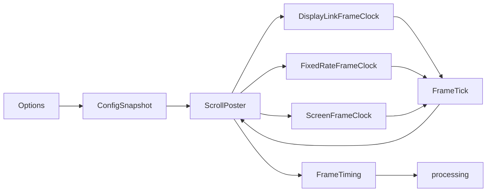

# 滚动帧管线: 可切换帧时钟与时间归一化

ScrollPoster 接收滚轮输入并输出平滑滚动事件. 「平滑手感归一化（实验性）」按滚动起点所在屏幕的实际回调出帧. 默认时钟为 CVDisplayLink. 位移按实际帧间隔换算, 插值参数以 60 Hz 为基准. 启动参数可独立指定帧时钟. [FrameTiming](../../Mos/ScrollCore/FrameClock/FrameTiming.swift)

## 范围

- 包含: 三种帧时钟, 按 60 Hz 基准的时间归一化与位移取整
- 不包含: 插值算法本身的调整, 适配器路由 (项目 A) 的行为变化, Monitor 重做 (任务 3)

## 抽取帧时钟前的实现

ScrollPoster 同时承担两类职责:

| 职责 | 位置 | 内容 |
|---|---|---|
| 帧驱动 | ScrollPoster.create / tryStart / stop, keeper, 刷新率自纠, AppDelegate 的显示器变化重建 | CVDisplayLinkCreateWithActiveCGDisplays, 僵尸检测, 冷却期重建, 标称刷新率复查 (issue #958) |
| 每帧计算 | ScrollPoster.processing | 插值比例 trans, ScrollFilter 的 0.23 / 0.5 / 0.77 平滑窗口, 死区; 阈值 (0.18 s, 0.45 s 等) 按秒定义 |

插值比例, 平滑窗口与死区按帧定义。刷新率越高, 同一次滚动越短越急; 多显示器刷新率不同时, CVDisplayLink 绑定的显示器决定手感。

## 方案

### 结构

| 组件 | 位置 | 职责 |
|---|---|---|
| ScrollFrameClock 协议 | Mos/ScrollCore/FrameClock/ScrollFrameClock.swift | 时钟启停、重建与逐帧回调 |
| DisplayLinkFrameClock | Mos/ScrollCore/FrameClock/DisplayLinkFrameClock.swift | 创建并监测 CVDisplayLink. 新会话跨屏时在停止的实例上换绑, 根据选定屏幕复查时钟 |
| FixedRateFrameClock | Mos/ScrollCore/FrameClock/FixedRateFrameClock.swift | DispatchSourceTimer 在串行队列上按 1/60 s 调度回调, 依据单调时钟记录实际间隔 |
| ScreenFrameClock | Mos/ScrollCore/FrameClock/ScreenFrameClock.swift | macOS 14 起可用, 通过 NSScreen.displayLink 跟随滚动会话起点所在屏幕的刷新节奏 |
| FrameTick | ScrollFrameClock.swift | 本帧时间戳与实际帧间隔 (秒) |
| ScrollDisplayLayout | Mos/ScrollCore/FrameClock/ScrollDisplayLayout.swift | 缓存活跃屏幕的边界、标称刷新率与上次命中的屏幕 |
| FrameTiming | Mos/ScrollCore/FrameClock/FrameTiming.swift | 归一化关闭时返回原值. 开启时按 scale = 帧间隔 × 60 换算按帧定义的常数 |
| ScrollPointAccumulator | Mos/ScrollCore/FrameClock/FrameTiming.swift | 实验性模式下, Quartz 投递逐轴累积未达一个整点的位移. 新手势或新目标进程从零累计 |
| ScrollPoster | Mos/ScrollCore/ScrollPoster.swift | 提供 update、tryStart、stop, 内部选取帧时钟并统一处理插值、阶段与事件投递 |

### 归一化换算

例如在 120 Hz 屏和 60 Hz 屏上滚动, 分别按它们的回调节奏生成位移. 帧间隔越短, 单帧位移越小, 时间归一化让同一输入的滚动时长与累计位移接近. 显示器的标称刷新率用于时钟复查, 标称刷新率未知时依次采用系统报告的最大帧率或 60 Hz

| 常数 | 关闭 (现状) | 开启 (scale = dt × 60) |
|---|---|---|
| 插值比例 trans | trans | 1 − (1 − trans)^scale |
| 平滑窗口系数 0.23 | 0.23 | 1 − (1 − 0.23)^scale |
| 死区 deadZone (单帧位移) | deadZone | deadZone × scale |
| 按秒定义的阈值 | 不变 | 不变 |

scale 取两次时钟回调的间隔, 范围限制为 1/480 s 到 0.1 s. 首帧采用时钟报告的周期. 帧间隔恰好为 1/60 s 时, 浮点位移采用原有系数. 通过死区判断的位移按轴结转到后续帧, 减少 Quartz 逐帧取整造成的距离损失

### 开关

| 设置 | UserDefaults key | 默认值 | 位置 |
|---|---|---|---|
| 平滑手感归一化（实验性） | scrollFrameSync | 关 | 全局平滑滚动详细设置弹窗 |

读取时优先使用 `scrollFrameSync`. 早期实验版本的两个设置键中任一个为开启时, 合并后的开关初始为开启

### 切换时机

- ScrollPoster 保存新会话首个滚轮事件的坐标, 在启动时钟前检查上次命中屏幕的边界. 出界时遍历缓存的边界. CVDisplayLink 绑定同一屏幕时直接复用, 跨屏时换绑已停止的实例, 换绑失败或同屏刷新率改变时重建
- 显示配置变化或屏幕休眠、唤醒时清除边界和刷新率缓存. 当前会话沿用已捕获的时钟选择, 下一次会话读取最新配置
- NSScreen.displayLink 从缓存边界解析的显示器 ID 创建该会话的时钟

### 帧时钟参数

`--mos-scroll-clock` 接受下列值. 参数在当前进程生效, 可以组合归一化开启或关闭使用

| 参数值 | 帧时钟 |
|---|---|
| `cvdisplaylink` | CVDisplayLink |
| `timer` | 固定 60 Hz 的 DispatchSourceTimer |
| `nsscreen` | NSScreen.displayLink, 绑定当前滚动会话起点所在的屏幕 |

未指定参数时使用 CVDisplayLink. 指定 `nsscreen` 后若系统不支持、时钟无法启动或未收到首帧, 本次进程回退到定时器, 继续使用当前归一化设置. 显式时钟选项的实际发帧率受该时钟回调能力限制

## 迁移步骤

设置关闭时沿用原有滚动行为

1. 引入 ScrollFrameClock 与 FrameTick, 把 CVDisplayLink 相关代码原样迁入 DisplayLinkFrameClock; ScrollPoster 通过协议驱动。补测试: 时钟替身驱动 processing, 现有 ScrollPoster 测试全部通过
2. 引入 FrameTiming 与位移取整, 验证 60 Hz、120 Hz、144 Hz 的累计输出
3. 支持三种时钟, 验证会话启停、参数选择与归一化的组合
4. 更新全局开关和本地化说明

## 设计决策

| 决策 | 理由 | 放弃的方案 |
|---|---|---|
| 先把现有链路原样迁入 DisplayLinkFrameClock, 再新增实现 | 两条链路共用同一个接口, 新链路出问题时关闭开关即回到迁移前的行为; 迁移本身可以用现有测试验证 | 在 ScrollPoster 内用条件分支并存两套 API 调用: 帧驱动与插值继续耦合, 后续删除旧链路时需要改动插值代码 |
| 收敛到同一个 ScrollPoster | 时钟负责报告帧间隔, 平滑滚动和事件投递共用同一套代码 | 每种时钟独立实现完整发送流程 |
| 只在空闲时替换时钟 | 会话中替换会让插值状态跨越两个时钟, 帧间隔出现跳变 | 设置变化时立即替换 |
| 在各屏原生节奏上按实际时间归一化 | 各屏使用自身回调频率, 位移采用共同的时间基准 | 所有屏幕共用较低的发帧档位 |

## 已知风险

- 实际出帧间隔取决于屏幕回调与系统调度. 目标应用的渲染节奏决定屏幕上的实际视觉表现
