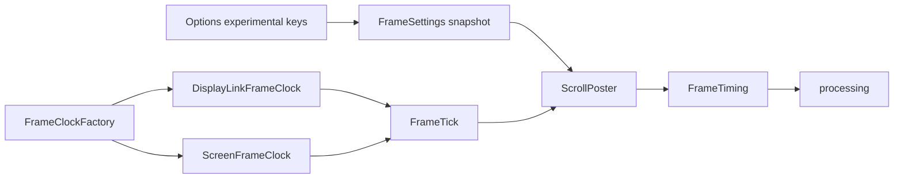

# 滚动帧管线: 可切换帧时钟与时间归一化

当前分支已接入基于 CVDisplayLink 的 `ScrollFrameClock` 和 `FrameTick`. NSScreen.displayLink, 时间归一化与设置开关仍处于方案阶段. [Lab 帧时钟](../../experiments/MirroringScrollLab/Sources/FrameClock.swift) · [Lab 插值换算](../../experiments/MirroringScrollLab/Sources/ScrollEngine.swift)

## 范围

- 包含: 帧时钟抽象与两种实现, 按 60 Hz 基准的时间归一化, 两个实验性开关, 切换时机与降级
- 不包含: 插值算法本身的调整, 适配器路由 (项目 A) 的行为变化, Monitor 重做 (任务 3)

## 抽取帧时钟前的实现

ScrollPoster 同时承担两类职责:

| 职责 | 位置 | 内容 |
|---|---|---|
| 帧驱动 | ScrollPoster.create / tryStart / stop, keeper, 刷新率自纠, AppDelegate 的显示器变化重建 | CVDisplayLinkCreateWithActiveCGDisplays, 僵尸检测, 冷却期重建, 标称刷新率复查 (issue #958) |
| 每帧计算 | ScrollPoster.processing | 插值比例 trans, ScrollFilter 的 0.23 / 0.5 / 0.77 平滑窗口, 死区; 阈值 (0.18 s, 0.45 s 等) 按秒定义 |

插值比例, 平滑窗口与死区按帧定义。刷新率越高, 同一次滚动越短越急; 多显示器刷新率不同时, CVDisplayLink 绑定的显示器决定手感。

## 方案

### 结构

| 组件 | 位置 | 职责 |
|---|---|---|
| ScrollFrameClock 协议 | Mos/ScrollCore/FrameClock/ScrollFrameClock.swift | start, stop, isRunning, nominalHz, onTick; 不含任何插值逻辑 |
| DisplayLinkFrameClock | Mos/ScrollCore/FrameClock/DisplayLinkFrameClock.swift | 现有 CVDisplayLink 逻辑整体迁入: 创建, keeper 僵尸检测, 冷却期重建, 刷新率自纠, 显示器变化重建。行为与迁移前逐项一致 |
| ScreenFrameClock | Mos/ScrollCore/FrameClock/ScreenFrameClock.swift | macOS 14+ 的 NSScreen.displayLink (CADisplayLink), 挂在专用线程的 RunLoop 上; 会话开始时绑定到事件位置所在的屏幕 |
| FrameClockFactory | 同目录 | 按设置与系统版本选择实现; 低于 macOS 14 或创建失败时返回 DisplayLinkFrameClock |
| FrameTick | ScrollFrameClock.swift | 本帧时间戳与实际帧间隔 (秒) |
| FrameTiming | Mos/ScrollCore/FrameTiming.swift | 纯函数: 归一化关闭时返回原值; 开启时按 scale = 帧间隔 × 60 换算按帧定义的常数 |
| ScrollPoster | 现有文件 | 持有当前时钟, 在 onTick 中调用 processing(tick); 不再直接调用 CVDisplayLink API |

### 归一化换算

| 常数 | 关闭 (现状) | 开启 (scale = dt × 60) |
|---|---|---|
| 插值比例 trans | trans | 1 − (1 − trans)^scale |
| 平滑窗口系数 0.23 | 0.23 | 1 − (1 − 0.23)^scale |
| 死区 deadZone (单帧位移) | deadZone | deadZone × scale |
| 按秒定义的阈值 | 不变 | 不变 |

scale 的帧间隔取时钟报告的实际间隔, 并限制在 1/480 s 到 0.1 s 之间, 避免卡顿帧放大单帧位移。60 Hz 屏幕上开启与关闭的输出一致。

### 开关

| 设置 | UserDefaults key | 默认值 | 位置 |
|---|---|---|---|
| 时间归一化 (实验性) | scrollTimeNormalization | 关 | 平滑滚动详细设置弹窗, 与 "模拟触控板" 同组 |
| 帧时钟: 屏幕同步 (实验性) | scrollScreenFrameClock | 关 | 同上; 低于 macOS 14 时禁用并显示原因 |

两个开关相互独立, 可组合出四种链路, 便于单变量 A/B 对比。两者都是全局设置: 帧时钟只有一个, 不随例外应用变化。

### 切换时机

- 设置变化只写入 FrameSettings 快照, 不立即替换时钟
- ScrollPoster 在会话空闲 (时钟已停止, 没有进行中的插值) 时比较快照与当前时钟类型, 不一致时释放旧时钟并创建新时钟
- 归一化开关在下一次 update (新会话或会话中的下一次输入) 时生效; processing 只读取 update 时捕获的快照, 与现有 ConfigSnapshot 的约定一致
- 会话进行中切换不会中断当前滚动, 也不会出现两个时钟同时驱动

### 降级

| 条件 | 行为 |
|---|---|
| macOS 低于 14 | 帧时钟开关禁用, 始终使用 DisplayLinkFrameClock |
| ScreenFrameClock 创建失败或 2 秒内没有回调 | 记录日志, 本次运行回退到 DisplayLinkFrameClock, 设置保持不变 |
| 两个开关均关闭 | 链路与迁移前完全一致 |

## 迁移步骤

每一步单独提交, 每一步结束时两个开关关闭的行为与 master 一致:

1. 引入 ScrollFrameClock 与 FrameTick, 把 CVDisplayLink 相关代码原样迁入 DisplayLinkFrameClock; ScrollPoster 通过协议驱动。补测试: 时钟替身驱动 processing, 现有 ScrollPoster 测试全部通过
2. 引入 FrameTiming 与归一化开关; 补测试: scale = 1 时输出与原公式逐位相同, 60 Hz / 120 Hz 下总位移与时长一致
3. 引入 ScreenFrameClock 与工厂, 帧时钟开关与空闲切换; 补测试: 工厂的版本与失败回退, 会话中切换被推迟到空闲
4. 设置界面与本地化 (两个开关, 版本不满足时的禁用说明)

## 设计决策

| 决策 | 理由 | 放弃的方案 |
|---|---|---|
| 先把现有链路原样迁入 DisplayLinkFrameClock, 再新增实现 | 两条链路共用同一个接口, 新链路出问题时关闭开关即回到迁移前的行为; 迁移本身可以用现有测试验证 | 在 ScrollPoster 内用条件分支并存两套 API 调用: 帧驱动与插值继续耦合, 后续删除旧链路时需要改动插值代码 |
| 帧时钟与归一化分成两个开关 | 两者分别影响 "何时出帧" 与 "每帧走多少", 合成一个开关时无法判断手感变化来自哪一项 | 单个 "新帧管线" 开关 |
| 只在空闲时替换时钟 | 会话中替换会让插值状态跨越两个时钟, 帧间隔出现跳变 | 设置变化时立即替换 |
| ScreenFrameClock 按会话起点绑定屏幕 | NSScreen.displayLink 绑定单个屏幕; 会话内光标跨屏的情况少, 下一次会话重新绑定 | 每帧检查光标所在屏幕 |
| 归一化基准固定为 60 Hz | Mos 现有参数在 60 Hz 下调校, 60 Hz 屏幕上开启后输出不变, 旧用户的手感基线保留 | 跟随主屏刷新率: 换屏时手感变化 |

## 已知风险

- ScreenFrameClock 的回调线程与现有 CVDisplayLink 线程不同, processing 的加锁约定需要在步骤 3 中复核
- 刷新率自纠 (issue #958) 只针对 CVDisplayLink 的过渡刷新率问题; NSScreen.displayLink 是否存在同类问题未验证
- 归一化改变高刷屏上的手感, 开启后的参数是否需要重新调校, 需要实机反馈
