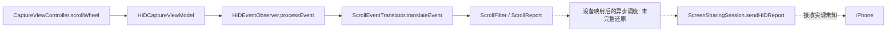

# iPhone Mirroring 滚动机制与实验交接 (2026-10-09)

> 2026-10-09 的机制还原与实验设计. 10 月 10 日完成 P0 字段记录与离线核对. 10 月 12 日的 E1–E3 实测补充了 P1/P2 所关注的 sender, 字段与惯性证据. 合入方案见[研究索引](00-README.md), 样本和未完成项见[实验记录](03-experiment-log.md)

## 2026-10-09 的结论与未知

对能滚和控制方向这两个目标, 2026-07-11 已存实验支持虚拟 HID 可选. 对细粒度连续滚动, 阶段切换, 惯性以及再次输入打断惯性的完整体验, 纯 CGEvent 替代方案仍待验证. 本轮没有重跑设备实验.

当时 Mos 的标准平滑路径改写 Point Delta. 已还原的镜像转换器在非零 sender 分支读取 Raw/Accelerated Delta. 两者的差异为后续字段对照提供了实验条件

| 判断 | 证据等级 | 限度 |
|---|---|---|
| 镜像存在 NSEvent/CGEvent 滚动转换路径 | 本轮 Mac 端静态还原 | 未证明所有事件均经过该入口 |
| 非零 sender 分支读取 175..178 | 本轮反汇编, 离线字段隔离支持 | 真实接收事件值未知 |
| 修改 88/96/97 不会同步修改 175..178 | 本轮离线探针实测 | 没有向镜像投递 |
| 非虚拟 HID 能滚且方向可控 | 历史设备实验记录 | 当前系统版本未重测 |
| 虚拟 Magic Trackpad 能顺滑滚动 | 已有 Lab 记录 | 有间歇失败和物理输入干扰 |
| 纯 CGEvent 可提供完整触控板体验 | 尚未验证 | 当前 Lab 没有测试完整字段路径 |

iPhone 接收实现, 设备属性的远端依赖, 各类 delta 的单位关系, 接收后的去重与加速规则均未知. 本轮也没有记录 iPhone 机型, iOS 版本和镜像画面的实际刷新率.

## 研究目标与工作区

用户最初要求研究镜像读取滚动的方式, 解释 Mos 与系统触控板的差异. 研究随后深入到核心转换机制, 并围绕已经尝试的虚拟 Magic Trackpad 方案判断必要性. 交接目标是让下一编码会话实现并执行实验, 用结果选择方案.

环境与 Git 状态需要在下一会话开始时重新核对. 本轮快照保存在 [environment-and-worktree.txt](evidence/2026-10-09/environment-and-worktree.txt).

| 项目 | 本轮快照 |
|---|---|
| 运行系统 | macOS 26.7.1, Build 25G241 |
| iPhone Mirroring | 1.6 (98.5), arm64e |
| 当前 SDK | macOS 27.0; 与运行系统分开记录 |
| 主工作区 | /Users/caldis/Desktop/Code/Mos, master, HEAD 8a2fd112, 初始干净 |
| 研究工作树 | /Users/caldis/Desktop/Code/Mos/.claude/worktrees/iphone-mirroring |
| 研究分支 | research/iphone-mirroring-scroll, HEAD 752730c, 初始已有未提交改动 |

下表保留当时工作区快照, 对应工具与记录随后归档于 `a06b130` 和 `fc862fe`

| 已有改动类型 | 路径 |
|---|---|
| 已修改研究文档 | docs/research/iphone-mirroring-scroll/00-README.md, 03-experiment-log.md, 04-entitlement-application.md |
| 已修改探针 | experiments/MirroringHIDProbe/Sources/MirroringHIDProbe/MirroringHIDProbe.swift |
| 未跟踪探针与工程文件 | 同目录 MagicTrackpadProbe.swift, TouchpadProbe.swift; experiments/MirroringHIDProbe/project.yml, tools/ |
| 未跟踪实验应用 | experiments/MirroringScrollLab/ |

磁盘偏好快照显示正式 Mos 的 smooth=true, smoothSimTrackpad=false; 镜像例外继承全局设置. Debug 配置为 smooth=true, smoothSimTrackpad=false, 例外为空. 这些是磁盘值, 运行进程内存中的配置未验证.

## 已查明的 Mac 端链路

本机二进制确认了窗口入口, 事件转换和报告编码路径, 以及后续发送接口. 设备映射后的异步消息调度尚未完整还原. Apple 私有框架闭源, 下述代码是反汇编后的语义还原. 网络发送内部与 iPhone 接收处理仍未知, 不能把它当作 Apple 原始源码或全部运行路径.



入口位于 ScreenContinuityUI 的 image offset 0x33DF0; ScrollEventTranslator 位于 UniversalHIDKit 的 offset 0x53AC. 入口, 设备映射和发送接口原型见 [screencontinuity-ui-segments.txt](evidence/2026-10-09/screencontinuity-ui-segments.txt). 转换器原始指令, image UUID 和地址解释见 [mos-iphone-scroll-core.txt](evidence/2026-10-09/mos-iphone-scroll-core.txt). 完整链路和逐段注释见 [06-scroll-pipeline.pseudo.swift](06-scroll-pipeline.pseudo.swift).

核心转换可简化为以下伪代码. 这里的 phase 和 momentum 来自 NSEvent, 数值域与 CGEvent 字段不同.

```text
translateScroll(ns):
    if ns.type != scrollWheel(22): return []
    cg = ns.cgEvent
    sender = cg?.integer(87) ?? 0
    if cg exists and sender != 0:
        rawXY = (cg.double(177), cg.double(178))
        acceleratedXY = (cg.double(175), cg.double(176))
        interrupted = (cg.integer(173) & 0x10) != 0
        if cg.integer(137) == 1:
            rawXY = -rawXY; acceleratedXY = -acceleratedXY
        parent = IOHIDScroll(ns.timestamp * 1e9, rawXY)
        child = IOHIDScroll(ns.timestamp * 1e9, acceleratedXY, acceleratedFlag)
        parent.append(child)
    else:
        interrupted = false
        parent = IOHIDScroll(ns.timestamp * 1e9, ns.scrollingDeltaX/Y)
    parent.senderID = sender
    parent.phase = mapNSEventPhase(ns.phase)
    parent.momentum = mapNSEventMomentum(ns.momentumPhase)
                      | (interrupted ? 0x10 : 0)
    return [parent]
```

非零 sender 分支没有读取 Point Delta 96/97 或 Continuous 88, 也没有调用 hasPreciseScrollingDeltas. 零 sender 或无 CGEvent 时, 转换器使用 NSEvent.scrollingDelta, 只产生父事件.

| NSEvent 输入 | 转换结果 |
|---|---|
| phase Began=1 | HID began |
| phase Stationary=2 / Changed=4 | HID changed |
| phase Ended=8 / Cancelled=16 / MayBegin=32 | HID ended / canceled / mayBegin |
| momentum Began=1 / MayBegin=32 | HID start=2 |
| momentum Changed=4 | HID continue=1 |
| momentum Ended=8 / Cancelled=16 | HID end=4 |

ScrollCollection 将父事件 Raw X/Y 四舍五入, 中点远离零, 再限制到 [-128, 127] 并编码为 Int8. Accelerated X/Y 用 HIDFixed 编码, 保留小数能力. 零 sender 回退路径没有 accelerated 子事件, 该部分报告值为零. Raw delta 不能直接视为屏幕像素浮点位移.

已检查的 Translator, EventObserver 和 ScrollFilter 没有按 delta, eventID 或旧 timestamp 去重. ScrollFilter 读取时间并写入报告. 这个结论只覆盖已检查的 Mac 路径, 远端去重规则仍未知.

设备查询按现有 HID serviceID 匹配 sender. 零 sender 在原查询中返回 nil, 但 UI 上层会先将零 sender 的 scroll 映射到 basicMouseServiceID. 因此零 sender 不能直接判为必丢弃, 回退路径的精细滚动能力仍需测试.

设备属性包括 deviceTypeHint, supportsGestureScrolling, dispatchScrollEvents, useRemoteAcceleration, scrollResolution, scrollReportRate 和 reportDescriptor. Mac 转换器中没有看到 Magic 品牌或型号要求; iPhone 对这些属性的依赖未知. 符号与 SDK 字段定义见 [sdk-and-service-properties.txt](evidence/2026-10-09/sdk-and-service-properties.txt).

Apple 的 [TN3210](https://developer.apple.com/documentation/technotes/tn3210-optimizing-your-app-for-iphone-mirroring) 描述了手机侧的公开输入契约: 镜像将 Mac 输入转换成 iPad 已有的间接输入, 滚动由 UIEvent.EventType.scroll 表达. 真实触控板和 Magic Mouse 对应 continuous, 普通滚轮鼠标对应 discrete. 自定义 UIPanGestureRecognizer 通过 allowedScrollTypesMask 选择接受连续滚动或全部滚动类型.

这份公开契约没有给出合成 CGEvent 的分类算法. Mac 端字段完整, 不等于手机侧必然获得 continuous 输入; 该项需要与设备属性和画面响应一起验证.

## 2026-10-09 的 Mos 与真实触控板字段差异

当时的 `ScrollCore.swift` 放行触控板事件, 真实触控板的字段随事件继续传递. 鼠标平滑复制原事件模板, 每帧改写部分公开字段. [源码快照](https://github.com/Caldis/Mos/blob/8a2fd112/Mos/ScrollCore/ScrollCore.swift#L79)

模板捕获见 `ScrollDispatchContext.swift` 第 55 行, 每帧克隆见第 96 行, 按进程投递见第 131 行. `ScrollPoster.post` 改写 Point 96/97, Continuous 88 和合成标记, 并可改写 phase 99 和 momentum 123. [投递上下文快照](https://github.com/Caldis/Mos/blob/8a2fd112/Mos/ScrollCore/ScrollDispatchContext.swift) · [平滑投递快照](https://github.com/Caldis/Mos/blob/8a2fd112/Mos/ScrollCore/ScrollPoster.swift#L510)

若合成事件仍保留非零 sender, 且抵达上述转换器分支, 每个平滑帧可能重复读取模板里旧的 Raw/Accelerated 值. 模板复制与字段不联动已经得到离线验证. 实际镜像接收值以及 postToPid 的到达情况仍需采样, 投递层级必须作为独立变量控制.

## 本轮离线探针结果

三组探针仅构造和复制 CGEvent/NSEvent. 没有 post, event tap, 应用启动或真实设备测试. 源码和输出已归档, 可据此复核字段行为.

| 操作 | 观测 | 实验含义 |
|---|---|---|
| 设置 Point 96/97 与 Continuous 88 | 175..178 保持不变 | Point 更新不补齐 Raw/Accelerated |
| 复制带 sender 与 sentinel 的事件 | 87, 175..178, timestamp 保留 | 鼠标模板可能重复携带旧值 |
| Point 调用 setDouble(7.5) | 读取结果为 7 | Point 字段仍是整数, 不能承载亚像素 |
| Point X/Y 从 3/2 改为 -55/44 | Raw X/Y 仍为 8.5/7.625, Accel X/Y 仍为 3.25/2.75 | NSEvent 读到新 Point, 非零 sender 转换器仍读旧四值 |
| 173 先设 50 (0x30 \| 2), 再将 123 设 1 | 173 变为 1 | 写 123 会覆盖 173 整值, 清掉 interrupted 的 0x10 位 |

字段 123 的读取只看到 173 的低 4 位. 实际设备会产生的 interrupted 标记尚未采样, 下一轮需要同时记录并控制两者的写入顺序.

CGEvent scroll phase 的 Changed=2, NSEvent.phase 的 Changed=4; CGEvent momentum 的 Continue=2, NSEvent.momentumPhase 的 Changed=4. 实现中应分别映射, 不得把一个数值域直接写成另一个. 映射摘段见 [appkit-phase-mapping.txt](evidence/2026-10-09/appkit-phase-mapping.txt). 当前 SDK 公开列出 173 和 175..178 的枚举名称; 87 与 137 没有公开枚举名称, 语义来自对应 getter 的反汇编.

## 2026-10-09 的 Lab 基线

7 月实测验证了 HID 层 CGEvent 投递与方向控制, 也记录了消费 237 个物理事件后镜像停止滚动. 消费与重投组合取得支持性结果, 同手势方向对照因断连中止. [Phase 2 实验记录](03-experiment-log.md#phase-2--cgevent-投递与消费)

当时的 phased 模式写入 88, 99, 123, 96/97, 93/94, 11/12 及可选 sender 87, 字段 175–178 尚未接入. 后续 Lab 已支持补齐字段并对照 sender. Lab 能使用零 sender, 真实触控板 sender 或 AppleMultitouchDevice ID. 服务映射仍是解释实验结果的前提. [Lab 引擎](../../../experiments/MirroringScrollLab/Sources/ScrollEngine.swift) · [字段与 sender 对照](03-experiment-log.md#2026-10-12-实验配置)

虚拟 Magic Trackpad 实验将每帧输出换算成触点移动, 系统再生成 Raw/Accelerated, 阶段和惯性. 该方案同时改变字段, 设备服务和手势识别过程. 原型曾取得顺滑结果, 也记录到间歇只有 MayBegin/Cancelled 或无事件. 通用数字化仪触控板只产生过 type 29, subtype 0, 当时未观测到滚动. [虚拟设备原型](../../../experiments/MirroringScrollLab/Sources/VirtualDevices.swift) · [Lab 代码指南](../../../experiments/MirroringScrollLab/CODE-GUIDE.md)

## 2026-10-09 的实验设计

P0 的实现与离线验证见[实验记录](03-experiment-log.md). P1/P2 保留为完整变量矩阵, 10 月 12 日的 E1–E3 为其中部分问题提供了实测证据

### P0: 建立可追踪的输入与输出

每帧记录捕获事件与发出事件两份数据, 保留会话编号和帧编号. 最小日志内容为:

```text
sender87, continuous88, line11/12, fixed93/94, point96/97,
scrollPhase99, momentum123, inverted137, optionPhase173,
accelerated175/176, raw177/178,
CGEvent timestamp, NSEvent timestamp, scheduledTime, actualPostTime,
captured/emitted, postTarget, targetPID, location, consume/repost 状态
```

同时保存当前 IOHIDEventService id 与设备属性映射. 从真实鼠标和触控板样本标定 Raw, Accelerated 与 Point 的符号, 单位和倍率. 直接把 Point 四份复制到 175..178 不构成正确标定. 用户的物理输入应与自动生成帧分时采样, 防止混入实验会话.

### P1: 检验完整字段的纯 CGEvent 路径

主对照统一使用 .cghidEventTap 投递, 消费原始输入以避免双份. 使用同一个已验证的真实鼠标 service sender, 只改变每帧 Raw/Accelerated 的更新策略. 真实触控板 service sender 作为下一组设备属性对照, 禁止捏造 ID.

| 组别 | sender 与投递 | 每帧字段策略 | 用途 |
|---|---|---|---|
| V | 已成功虚拟 Magic Trackpad 配置 | 系统生成完整事件 | 阳性基线 |
| M0 | 有效真实鼠标 sender, HID tap | 当前 Point 版本, 其余保持模板 | 重现现有字段差异 |
| M1 | 与 M0 相同 | 按标定补齐 Raw/Accelerated, 其余同 M0 | 字段单变量比较 |
| T0 / T1 | 有效真实触控板 service sender, HID tap | 同 M0 / M1 两种策略 | 设备服务属性对照 |

任一 sender 无法匹配现有服务, 或未证实事件到达, 该轮标为无效实验. 虚拟基线若在同轮失效, 先恢复有效基线, 再解释 CGEvent 组结果.

初始序列建议使用 Began, 40 个 Changed, Ended, Changed 间隔 16 ms. 分开测试增量幅度 1, 4, 16, 再测试 Accelerated 中的亚像素增量. Raw 与 Accelerated 的单位关系沿用真实样本标定, 小数值在 Raw 编码中的取整影响需要记录.

保持总位移与总时长相同, 比较 20 帧与 40 帧的序列, 例如 20×32 ms 对 40×16 ms. 这可减少速度和持续时间差异. 再覆盖慢拖, 松手, 惯性期间再次输入和横向滚动. Fresh timestamp 与复制旧 timestamp 单独分组, 不与 delta 字段策略同时改变.

每种条件至少执行 5 次有效重复, A/B 交替或随机排序. 固定镜像中的滚动内容, 起点, 焦点, 光标位置与显示设置. 将原始事件消费, 重投位置, sender, phase 序列和预期总输入写入每轮配置.

### P2: 分离阶段, 设备属性与投递影响

P1 完成后, 独立比较 phase 序列与 173 interrupted 位的保留策略. 写 123 的顺序需要控制, 避免无意清除 173 高位. 只在真实样本支持时构造惯性打断条件.

设备服务属性对照用于区分"字段完整即足够"与"还依赖有效服务属性". 零 sender 回退可作为附加组. postToPid 与 HID tap 放在单独投递对照中, 避免把投递失败解释成转换器拒绝完整字段.

测量发出事件数, 可观测接收事件数, 画面内容位移, 停止后的尾部位移, 最大单帧跳变, 相邻帧无移动比例和失效次数. 画面位移从固定内容区域的像素位置计算; Point 值与画面像素值须分开记录. 无接收端日志时, 接收事件数标为未知.

60 Hz 条件可以用 60 fps 视频分析; 120 Hz 条件需要相应录制率. 录制率不足时报告采样限制, 不据此声称已排除帧间跳变. 将原始视频, 帧日志, 配置和服务映射保存在同一轮证据目录.

## 结果判据与停止条件

可判定的结果必须同时具备有效服务映射, 受控投递, 完整字段日志和可比较的画面记录. "看起来顺滑"可作为观察, 决策仍要使用事前约定的位移与连续性容差.

| 结果 | 可以得到的结论 |
|---|---|
| M1 比 M0 改善且达到 V 的既定容差 | 在测试范围内, 虚拟 Magic Trackpad 可选; 完整字段方案值得继续 |
| M1 失败, T1 成功且达到容差 | 有效服务属性可能必要; 尚不能推出虚拟设备必要 |
| M1/T1 均有效到达但失败, V 稳定成功 | 增强设备/手势路径依赖的证据, 继续定位差异 |
| 字段完整, 但事件到达, sender 服务映射或阳性基线未确认 | 无效实验, 暂不作方案结论 |
| 仅能滚或控制方向, 连续性/惯性不达容差 | 只确认该项能力, 完整体验仍待验证 |

即使完整 CGEvent 组失败, 也只覆盖本轮版本, 服务属性和参数范围. 证明虚拟 HID 必要, 还需要排除标定, phase, 投递和远端设备属性等差异.

运行真实设备测试或需要本机权限/设备状态的操作, 需遵守 AGENTS.md 的用户确认边界. 这份交接不授予运行权限. 单轮仅运行一个输入工具, 事前准备退出方式; 输入卡住先停止 probe.

先在实验 Lab 验证, 保留生产 Mos 实现和现有 dirty 改动. 不通过修改全局自然滚动, 权限或持久化设置绕过失败. 不自动使用 adhoc 签名启动完整 Mos 测试; 测试前按项目规则检查运行实例和签名风险. 本轮只整理报告与证据, 没有 commit, push, 签名, 注入或真实设备实验.

## 证据导航

以下文件保存本轮证据, 主链引用使用仓库内路径, 避免依赖临时目录. 源码位置以所列 Git 快照为准, 后续变动需要重新核对行号.

- [完整链路伪代码与注释](06-scroll-pipeline.pseudo.swift): Mac 入口, 观察器, 转换, 编码, 设备映射和发送边界
- [核心反汇编与语义还原](evidence/2026-10-09/mos-iphone-scroll-core.txt): 简版伪代码在第 15-44 行, 后续为原始指令
- [ScreenContinuityUI 摘段](evidence/2026-10-09/screencontinuity-ui-segments.txt): 窗口入口, 设备映射和发送接口原型
- [字段探针源码](evidence/2026-10-09/mos-scroll-field-probe.swift) 与 [输出](evidence/2026-10-09/mos-scroll-field-probe.txt): 公开字段与 Raw/Accelerated 的隔离
- [字段隔离源码](evidence/2026-10-09/mos-scroll-field-isolation.swift) 与 [输出](evidence/2026-10-09/mos-scroll-field-isolation.txt): sender, sentinel, 复制与 NSEvent 读取
- [动量别名源码](evidence/2026-10-09/mos-scroll-momentum-alias.swift) 与 [输出](evidence/2026-10-09/mos-scroll-momentum-alias.txt): 123/173 共享状态与高位覆盖
- [SDK 与设备属性](evidence/2026-10-09/sdk-and-service-properties.txt): 字段公开名称和服务属性符号
- [AppKit phase 映射](evidence/2026-10-09/appkit-phase-mapping.txt): CGEvent 与 NSEvent 数值域的转换
- [Apple TN3210](https://developer.apple.com/documentation/technotes/tn3210-optimizing-your-app-for-iphone-mirroring): 手机侧间接输入及 continuous/discrete 的公开契约
- [环境与工作树快照](evidence/2026-10-09/environment-and-worktree.txt): 版本, Git 状态与磁盘设置
- 7 月探针结果, 9 月 CoreHID 复测和 10 月 Lab 对照. [实验记录](03-experiment-log.md)
- 虚拟 Magic Trackpad 成功记录与间歇失败. [Lab 代码指南](../../../experiments/MirroringScrollLab/CODE-GUIDE.md)
